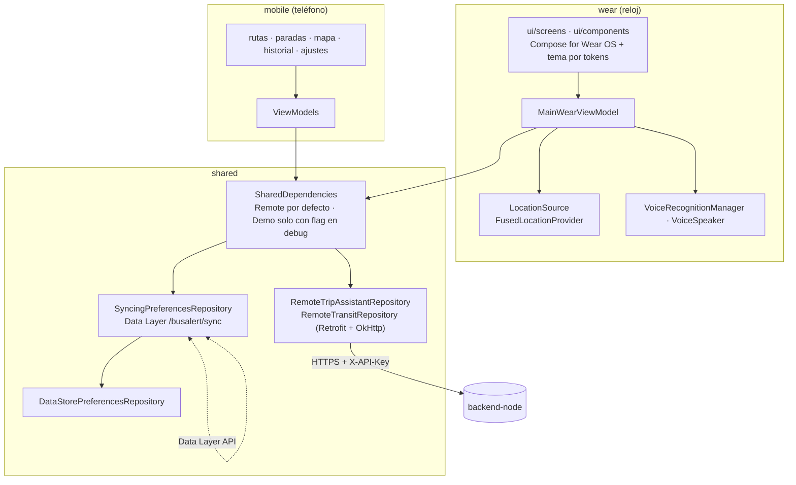

# BusAlert — Android (Wear OS + móvil)

Proyecto Android multi-módulo del asistente de transporte BusAlert para San Juan de Pasto.



El reloj **no** habla con la IA directamente: llama al backend (`backend-node`), que es quien tiene la clave de Gemini y los datos de rutas.

## Requisitos

- Android Studio con SDK 34.
- **JDK 17** para Gradle. El JBR 25 que trae Android Studio no funciona con Gradle 8.4: configura `JAVA_HOME` o en Android Studio *Settings → Build → Gradle → Gradle JDK* elige un JDK 17.
- El backend corriendo (ver `../backend-node/README.md`).

## Configuración

Los valores se leen de variables de entorno o de `local.properties` (que no se sube a git). Nunca van en el código.

| Propiedad (`local.properties`) | Variable de entorno | Uso |
|---|---|---|
| `busalert.apiKey` | `BUSALERT_API_KEY` | Clave de aplicación; debe estar en `API_KEYS` del backend. |
| `busalert.debug.backendUrl` | `BUSALERT_DEBUG_BACKEND_URL` | URL del backend en debug. Por defecto `http://10.0.2.2:3000/` (la PC vista desde el emulador). |
| `busalert.release.backendUrl` | `BUSALERT_RELEASE_BACKEND_URL` | URL **HTTPS** en release. Sin ella el build release se detiene. |
| `busalert.useMock` | `BUSALERT_USE_MOCK` | `true` = datos de demostración sin backend (solo en debug; en release siempre es `false`). |
| `busalert.mapsApiKey` | `BUSALERT_MAPS_API_KEY` | Clave de Google Maps para el mapa de la app del teléfono (opcional). |

Ejemplo de `local.properties`:

```properties
sdk.dir=C\:\\Users\\<usuario>\\AppData\\Local\\Android\\Sdk
busalert.apiKey=<la misma clave que en API_KEYS del backend>
```

Si falta la URL o la clave, la app no se cae: muestra "La app no tiene configurado el servidor".

## Comandos

```bash
./gradlew assembleDebug        # APKs de debug (wear y mobile)
./gradlew testDebugUnitTest    # Pruebas JVM: ViewModel, repositorio (MockWebServer), UI (Robolectric), contratos
./gradlew lintDebug            # Android Lint (los avisos también fallan)
./gradlew :wear:installDebug   # Instalar en el emulador/reloj conectado
```

## Pruebas

- `shared`: `RemoteTripAssistantRepository` contra MockWebServer, usando las respuestas reales del backend guardadas en `../contracts/` (si el backend cambia el formato, estas pruebas fallan).
- `wear`: `MainWearViewModel` (todas las transiciones, errores, reintento y cancelación) con coroutines-test y Turbine. Pantallas de Compose con Robolectric en español e inglés y contraste del tema.
- `mobile`: ViewModels y navegación completa con Robolectric.
- `shared`: también la sincronización (formato, conflictos y publicación) y DataStore.

## Interfaz del reloj

- `wear/.../theme/`: sistema de diseño (paleta, roles de color claro/oscuro, espaciado, dimensiones, movimiento). Los composables no tienen valores literales.
- `wear/.../ui/components/`: piezas reutilizables (scaffold con hora, viñeta e indicador de scroll, chips, insignia de ruta, animaciones).
- `wear/.../ui/screens/`: una pantalla por archivo (inicio, ajustes, escucha, escritura, progreso, resultado y mensajes).
- `wear/.../ui/WearApp.kt`: navegación por estado, permisos, voz y háptica.
- Previews en `ui/preview/WearPreviews.kt`: redondo pequeño y grande, cuadrado, claro/oscuro, español/inglés.
- Accesibilidad: objetivos táctiles de Wear (chips ≥ 52 dp), descripciones para TalkBack, regiones vivas en la transcripción, texto escalable y contraste AA verificado por pruebas.
- Preferencias (idioma, tema, lectura en voz alta) e historial en DataStore; las sugerencias al escribir salen del historial.
- Para escribir se usa la entrada de texto del sistema (teclado, escritura a mano o dictado).

## App del teléfono

- Pestañas: **Rutas** (búsqueda sin tildes, favoritos primero, detalle con sentidos, mapa y paradas en orden), **Paradas** (búsqueda con las rutas que pasan), **Historial** (consultas del reloj y favoritos) y **Ajustes** (idioma, tema, lectura en voz alta del reloj).
- Material 3 con tema por tokens (`mobile/.../theme/Theme.kt`) y textos en `strings.xml` es/en.

## Sincronización reloj ↔ teléfono

- Preferencias, historial y favoritos se guardan en DataStore (`shared/preferences`) y se sincronizan por la **Data Layer API** (`shared/sync`).
- Cada cambio local publica el estado completo con su hora; el otro dispositivo lo aplica si es más reciente.
- Las dos apps tienen el mismo `applicationId` (`com.busalert`) y deben firmarse con la misma clave.

## Errores y textos

El backend responde con **códigos** de error (`UNAUTHORIZED`, `RATE_LIMITED`...). `shared` los convierte en `ErrorCode` y la UI los traduce con `strings.xml` (`values/` en español, `values-en/` en inglés).
