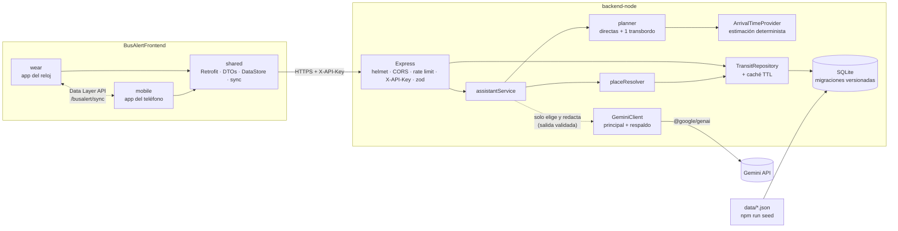

# BusAlert

Asistente de transporte público para **San Juan de Pasto (Colombia)**, pensado para relojes **Wear OS**. El usuario dice o escribe a dónde va (el origen sale del GPS o de lo que diga), y el reloj responde qué bus del SETP tomar, dónde subir y dónde bajar, en pantalla y en voz alta. Una app de teléfono permite consultar rutas y paradas y se sincroniza con el reloj.

[](.github/workflows/ci.yml)
[](LICENSE)

## Componentes

| Carpeta | Qué es |
|---|---|
| [`backend-node/`](backend-node/README.md) | API en Node.js + TypeScript + SQLite. Fuente única de rutas y paradas, planificador, estimación de tiempos e integración con Gemini. |
| [`BusAlertFrontend/`](BusAlertFrontend/README.md) | Proyecto Android: app del reloj (`wear`), app del teléfono (`mobile`) y módulo compartido (`shared`). |
| `contracts/` | Respuestas JSON reales del backend, usadas por las pruebas de los dos lados. |
| `docs/` | Estado (`ESTADO.md`), decisiones (`DECISIONES.md`), pendientes del dueño (`PENDIENTES.md`), auditoría (`AUDITORIA.md`) y verificación (`VERIFICACION.md`). |

## Arquitectura



- La **base de datos es la única fuente de verdad**. Los datos se cargan desde `backend-node/data/` con `npm run seed` (idempotente y validado).
- La **IA es opcional**: si no hay `GEMINI_API_KEY` o la IA falla, responde el planificador. La IA solo elige una de las alternativas calculadas y redacta el texto; no puede inventar rutas.
- El **reloj nunca habla con Gemini**: solo con el backend.

## Puesta en marcha desde cero

Requisitos: Node.js ≥ 22.13 (probado con 24), JDK 17, Android SDK 34.

```bash
# 1. Backend
cd backend-node
npm ci
cp .env.example .env        # define API_KEYS (16+ caracteres) y, si quieres IA, GEMINI_API_KEY
npm run seed                # crea la BD e importa data/
npm run dev                 # http://localhost:3000/health

# 2. Android
cd ../BusAlertFrontend
# en local.properties:
#   busalert.apiKey=<una de las claves de API_KEYS>
#   busalert.debug.backendUrl=http://<IP-de-tu-PC>:3000/   (opcional; por defecto el emulador: 10.0.2.2)
./gradlew :wear:installDebug :mobile:installDebug
```

Variables de entorno del backend: [`backend-node/.env.example`](backend-node/.env.example) (todas documentadas). Propiedades de Android: [`BusAlertFrontend/README.md`](BusAlertFrontend/README.md#configuración).

## Despliegue del backend

```bash
cd backend-node
docker build -t busalert-backend .
docker run -d -p 3000:3000 \
  -e API_KEYS=<clave> -e GEMINI_API_KEY=<clave-opcional> \
  -v busalert-db:/app/var busalert-backend
```

La imagen ejecuta el seed al arrancar (idempotente) y expone `/health`. Detalles y despliegue sin Docker en [`backend-node/README.md`](backend-node/README.md#despliegue). En producción el backend debe ir detrás de HTTPS: el build release de Android exige una URL `https://`.

## Calidad

La CI (`.github/workflows/ci.yml`) ejecuta en cada push a `main`/`mejoras-profesionales` y en cada pull request:

- **Backend:** `npm run lint`, `format:check`, `typecheck`, `test`, `build` e importación de los datos reales.
- **Android:** `assembleDebug`, `testDebugUnitTest` y `lintDebug`.

## Licencia

MIT. Ver [LICENSE](LICENSE).
